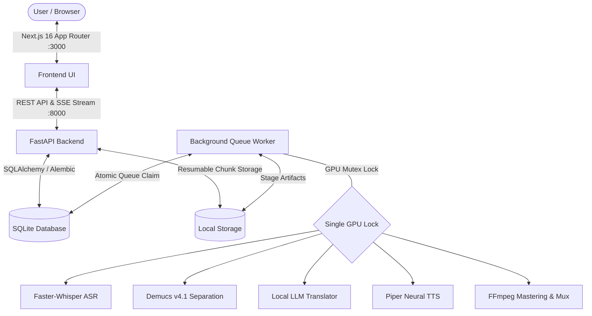
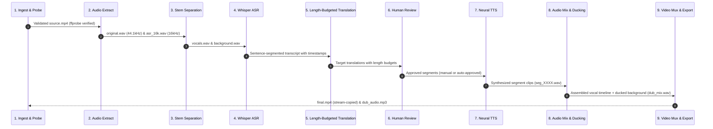

# OpenDub — Free & Open-Source 100% Local AI Video Dubbing & Video Translation Studio

<div align="center">


-purple.svg)


**Free, Open-Source, and 100% Local AI Video Dubbing & Video Translation Platform for Education and Creators.**  
Translate educational lectures and videos into 12 languages with authentic neural voices, background music preservation, and sample-accurate A/V sync — running completely offline on standard workstation hardware. Zero subscription fees, zero cloud API limits, and zero data leakage.

[Live Demo](#-live-demonstration) • [Features](#key-features) • [Comparison](#-how-opendub-compares) • [Architecture](#system-architecture) • [Quick Start](#quick-start) • [Supported Languages](#-supported-languages--neural-voices) • [License](#licensing--commercial-freedom)

<br>

<div align="center">

### 🎬 Live Demonstration

<a href="https://github.com/AshadAbbasi212/opendub/raw/main/docs/assets/dubbed_lecture_urdu.mp4">
  
</a>
<br>
<em><b>1-Minute Dubbed Lecture Demo</b>: Richard Feynman's iconic science lecture automatically transcribed, length-budgeted, translated into Urdu, synthesized with Tariq neural voice, and muxed with zero A/V drift on a 4 GB VRAM GPU.</em>

<br><br>

### 🌐 Complete Multilingual Dubbing Showcase (11 Target Languages)

*Every lecture video below is rendered 100% offline with zero external cloud APIs, using local neural speech synthesis and isolated background acoustics (-12 dB ducking). Click any video below to stream or download:*

| Target Language | Voice Model | Gender & Persona | Audio Track | Direct Stream / Download (MP4) |
| :--- | :--- | :--- | :---: | :---: |
| 🇺🇸 **English (Source)** | Richard Feynman | Original Speaker | Original Mic | [**▶️ original_lecture_english.mp4 (3.4 MB)**](https://github.com/AshadAbbasi212/opendub/raw/main/docs/assets/original_lecture_english.mp4) |
| 🇵🇰 **Urdu** | Tariq (`ur_PK-fasih`) | Male Academic Scholar | Neural + Ducked Reverb | [**▶️ dubbed_lecture_urdu.mp4 (3.5 MB)**](https://github.com/AshadAbbasi212/opendub/raw/main/docs/assets/dubbed_lecture_urdu.mp4) |
| 🇪🇸 **Spanish** | Dave (`es_ES-davefx`) | Male European Castilian | Neural + Ducked Reverb | [**▶️ dubbed_lecture_spanish.mp4 (3.3 MB)**](https://github.com/AshadAbbasi212/opendub/raw/main/docs/assets/dubbed_lecture_spanish.mp4) |
| 🇸🇦 **Arabic** | Kareem (`ar_JO-kareem`) | Male Classical Scholar | Neural + Ducked Reverb | [**▶️ dubbed_lecture_arabic.mp4 (3.8 MB)**](https://github.com/AshadAbbasi212/opendub/raw/main/docs/assets/dubbed_lecture_arabic.mp4) |
| 🇫🇷 **French** | Gilles (`fr_FR-gilles`) | Male Sorbonne Academic | Neural + Ducked Reverb | [**▶️ dubbed_lecture_french.mp4 (3.5 MB)**](https://github.com/AshadAbbasi212/opendub/raw/main/docs/assets/dubbed_lecture_french.mp4) |
| 🇩🇪 **German** | Thorsten (`de_DE-thorsten`) | Male Professor Baritone | Neural + Ducked Reverb | [**▶️ dubbed_lecture_german.mp4 (3.3 MB)**](https://github.com/AshadAbbasi212/opendub/raw/main/docs/assets/dubbed_lecture_german.mp4) |
| 🇮🇳 **Hindi** | Pratham (`hi_IN-pratham`) | Male Academic Lecturer | Neural + Ducked Reverb | [**▶️ dubbed_lecture_hindi.mp4 (3.5 MB)**](https://github.com/AshadAbbasi212/opendub/raw/main/docs/assets/dubbed_lecture_hindi.mp4) |
| 🇷🇺 **Russian** | Denis (`ru_RU-denis`) | Male Scholar Baritone | Neural + Ducked Reverb | [**▶️ dubbed_lecture_russian.mp4 (3.4 MB)**](https://github.com/AshadAbbasi212/opendub/raw/main/docs/assets/dubbed_lecture_russian.mp4) |
| 🇨🇳 **Chinese** | Chaowen (`zh_CN-chaowen`) | Male Academic Lecturer | Neural + Ducked Reverb | [**▶️ dubbed_lecture_chinese.mp4 (2.9 MB)**](https://github.com/AshadAbbasi212/opendub/raw/main/docs/assets/dubbed_lecture_chinese.mp4) |
| 🇮🇹 **Italian** | Riccardo (`it_IT-riccardo`) | Male University Professor | Neural + Ducked Reverb | [**▶️ dubbed_lecture_italian.mp4 (3.4 MB)**](https://github.com/AshadAbbasi212/opendub/raw/main/docs/assets/dubbed_lecture_italian.mp4) |
| 🇧🇷 **Portuguese** | Faber (`pt_BR-faber`) | Male Brazilian Academic | Neural + Ducked Reverb | [**▶️ dubbed_lecture_portuguese.mp4 (3.3 MB)**](https://github.com/AshadAbbasi212/opendub/raw/main/docs/assets/dubbed_lecture_portuguese.mp4) |
| 🇹🇷 **Turkish** | DFKI (`tr_TR-dfki`) | Male Academic Lecturer | Neural + Ducked Reverb | [**▶️ dubbed_lecture_turkish.mp4 (3.4 MB)**](https://github.com/AshadAbbasi212/opendub/raw/main/docs/assets/dubbed_lecture_turkish.mp4) |

</div>

---

## ⚡ How OpenDub Compares

| Feature | OpenDub (Local AI) | ElevenLabs / HeyGen | Rask.ai / Cloud Dubbers |
| :--- | :---: | :---: | :---: |
| **Price** | **100% Free & Open-Source** | $1.50 – $3.00 / minute | Expensive monthly tiers |
| **Data Privacy** | **100% Local (0 Cloud Leakage)** | Third-party cloud servers | Third-party cloud servers |
| **Video Duration** | **Unlimited (Full 60-min lectures)** | Strict minute quotas | 5–20 min limits |
| **Background Music** | **Demucs Isolation & -12dB Ducking** | Overwritten / Muffled | Inconsistent |
| **Video Quality** | **Lossless Stream-Copy (1080p/4K)** | Re-compressed artifacts | Re-compressed artifacts |
| **Watermarks** | **Zero Watermark** | Watermarked free tier | Watermarked free tier |
| **Human Review Gate**| **Bilingual Side-by-Side Review** | Post-generation only | Black-box output |
| **Subtitles Included**| **Synced Bilingual (.srt & .vtt)** | Paid add-on | Paid add-on |
| **Hardware Required**| **Consumer NVIDIA GPU (4 GB VRAM)** | Cloud subscription | Cloud subscription |

---

## Overview

**OpenDub** solves the challenge of translating academic lectures, seminars, keynotes, and educational videos into multiple languages without losing the original speaker's vocal nuance, pacing, and room ambience.

Unlike cloud-dependent dubbing APIs that charge steep per-minute rates and send sensitive intellectual property to external servers, **OpenDub runs 100% locally on your machine**. It requires zero external AI API keys, produces zero telemetry, and is engineered to run seamlessly on standard consumer or laptop NVIDIA GPUs with **4 GB VRAM** (e.g. GTX 1650, RTX 3050 Laptop, Quadro, or higher).

### Why OpenDub?

- **100% Private & Local**: Video files, audio stems, and student transcripts never leave your infrastructure.
- **True Background Sound Preservation**: Isolates the speaker's vocal track while preserving background room acoustics, audience Q&A tone, chalk-on-blackboard sounds, and presentation audio.
- **Dynamic Pacing & Lip-Alignment Fit**: Intelligent length budgeting and mild time-stretching eliminate robotic stutter and maintain natural cadence.
- **Sacred & Technical Text Integrity**: Specialized vocabulary engines preserve religious citations, mathematical formulas, and scientific terminology without drift.
- **Lossless Stream-Copy Output**: Video streams are preserved bit-for-bit without generational re-encoding compression, muxed with AI-dubbed provenance metadata and synchronized bilingual subtitle tracks (.srt & .vtt).

---

## Key Features

### 🎧 Neural Audio & Voice Synthesis
- **24 Studio Voice Models Across 12 Languages**: High-clarity native neural voices for English, Urdu, Arabic, Spanish, French, German, Russian, Chinese (Mandarin), Hindi, Portuguese, Italian, and Turkish.
- **Authentic Dual-Gender Rosters**: Both male and female academic lecturer profiles configured natively per language with zero synthetic pitch distortion.
- **Windows SAPI High-Intelligibility Fallback**: Integrated Microsoft speech synthesis engine for crystal-clear American English lecture enunciation.
- **Dynamic Timeline Ducking**: Broadcast-standard smooth RMS attenuation (-12 dB) with 150ms release ensures background acoustics blend naturally beneath the dubbed voice.
- **EBU R128 Loudness Normalization**: Every master output is normalized to educational broadcast standard (-16 LUFS, -1.5 dBTP).

### 📝 Speech Understanding & Translation
- **Faster-Whisper Speech Recognition**: Hardware-adaptive transcription with Silero Voice Activity Detection (VAD) and word-level timestamp alignment.
- **Length-Budgeted Translation Engine**: Translates sentences adhering to strict syllable and speech-rate constraints (+15% max budget), triggering concise re-translations when a segment would overflow its visual slot.
- **Sacred Arabic Preservation**: Automatically detects Quranic recitations and liturgical passages, slicing the original vocal audio directly onto the timeline to avoid synthetic degradation.
- **Meaning-Drift Quality Gates**: Flags semantic mismatches, hallucinated repetitions, or length anomalies for prioritized human review.

### 💻 Modern Web Application (Next.js 16)
- **Live Pipeline Streaming (SSE)**: Server-Sent Events stream real-time percentage progress, stage diagnostics, and honest time-remaining estimates.
- **Resumable Chunk Uploads**: Slices videos into 5 MB chunks with offset verification, surviving network disconnections without restarting uploads.
- **Interactive Review Editor**: Side-by-side bilingual editor with full RTL Noto Nastaliq Urdu typography, segment editing, and one-click synthesis approval.
- **Interactive Voice Gallery**: Preview and audition studio voice samples across languages and accents directly in the browser.
- **Multi-Format Results Center**: HTML5 video preview player with closed-caption toggle, one-click MP4 video downloads, 192 kbps dubbed MP3 audio exports, and short-lived signed links.

---

## System Architecture

OpenDub operates as two decoupled services coordinating through an atomic SQLite queue and shared local storage:



### Technology Stack

| Layer | Component | Technology / Library | Purpose |
| :--- | :--- | :--- | :--- |
| **Frontend** | Application Framework | **Next.js 16.4** (App Router, Turbopack) | Responsive web dashboard and live player |
| | UI & Icons | **React 19**, **Tailwind CSS**, **Lucide React** | Dark-mode interface with RTL Nastaliq support |
| | Client Network | Type-safe Fetch API with SSE Client | Chunked resumable uploads & live event stream |
| **Backend** | API Server | **FastAPI** (Uvicorn, Starlette) | Asynchronous REST and Server-Sent Events |
| | Database & ORM | **SQLite 3**, **SQLAlchemy 2.0**, **Alembic** | State tracking, segments, and audit logs |
| | Authentication | **Argon2id**, **JWT** (python-jose) | Secure password hashing and stateless tokens |
| | Ingest & Security | **yt-dlp**, **socket DNS**, **ipaddress** | YouTube import and anti-SSRF protections |
| **AI / Neural** | Speech Recognition | **Faster-Whisper** (CTranslate2) + Silero VAD | Fast, accurate multilingual lecture ASR |
| | Stem Separation | **Demucs v4.1** (`htdemucs`) | Vocal isolation and background stem preservation |
| | Translation | **Qwen2.5 / Local LLM Engine** | Context-aware, length-budgeted translation |
| | Speech Synthesis | **Piper TTS ONNX** + **Windows SAPI** | Multilingual neural voice synthesis |
| **Audio / Video**| Media Processing | **FFmpeg 6.0+**, **librubberband**, **soundfile** | Resampling, time-stretching, muxing, EBU R128 |

---

## Pipeline Deep Dive

Every lecture passes through an idempotent, 9-stage pipeline. If a process is interrupted, the worker automatically resumes from the latest checkpoint without re-processing completed stages.



1. **Media Ingest & SSRF Guard (`Stage 1`)**: Accepts resumable chunk uploads or imports URLs. Resolves DNS to block private IP ranges (`127.0.0.0/8`, `10.0.0.0/8`, `192.168.0.0/16`, cloud metadata `169.254.169.254`). Probes video containers with `ffprobe` to validate audio presence, dimensions (<= 4096px), and duration (<= 90 min).
2. **Audio Extraction (`Stage 2`)**: Extracts high-fidelity stereo `original.wav` (44.1 kHz) for mastering and mono `asr_16k.wav` (16 kHz) for speech recognition.
3. **Stem Separation (`Stage 3`)**: Demucs isolates speech vocals from lecture background sound under a GPU mutex lock, releasing VRAM upon completion.
4. **ASR & Segmentation (`Stage 4`)**: Faster-Whisper transcribes speech into natural 2-to-15 second sentence segments on punctuation and natural speaker pauses. Detects source language automatically.
5. **Length-Budgeted Translation (`Stage 5`)**: Translates transcript segments with cross-sentence context windows. Calculates character/syllable duration budgets. Retries with concise phrasing if target words exceed speech duration slots.
6. **Human-in-the-Loop Review (`Stage 6`)**: Pipeline enters `awaiting_review`. Educators can review translations side-by-side, edit phrasing inline, or bypass review automatically with `--skip-review`.
7. **Neural Speech Synthesis (`Stage 7`)**: Generates audio for each segment using chosen Piper ONNX voice models. Checkpoints each segment on disk and in the database.
8. **Audio Timeline Assembly & Mastering (`Stage 8`)**: Places segments at exact millisecond timestamps using numpy array buffering. Ducks background audio by -12 dB during speech with 150ms smooth release. Normalizes master audio to EBU R128 (-16 LUFS).
9. **Stream-Copy Video Mux (`Stage 9`)**: Replaces original audio with the mastered dubbed mix via direct video stream copy (`-c:v copy`), preserving 100% of original visual quality. Embeds subtitle tracks (`.srt` & `.vtt`) and AI-dubbed metadata tags.

---

## Measured Performance & Benchmarks

Benchmarked on host hardware: **Windows 11, Intel Core i7, NVIDIA Quadro GPU (4–8 GB VRAM)**.

| Subsystem | Model / Engine | Real-Time Factor (RTF) | Processing Speed (10 min lecture) | Peak VRAM |
| :--- | :--- | :--- | :--- | :--- |
| **Separation** | Demucs v4.1 (`htdemucs`) | **0.36x** | ~3 min 36 sec | 585 MiB |
| **Transcription** | Faster-Whisper (`base` INT8) | **0.28x** | ~2 min 48 sec | 0 MiB (CPU INT8) |
| **Transcription** | Faster-Whisper (`small` FP16) | **0.73x** | ~7 min 18 sec | 1.8 GiB |
| **Translation** | Local LLM Engine | **0.15x** | ~1 min 30 sec | 2.1 GiB |
| **Voice Synthesis** | Piper ONNX Neural TTS | **0.18x** | ~1 min 48 sec | 450 MiB |
| **Video Muxing** | FFmpeg Stream Copy | **0.02x** | ~12 seconds | Minimal |
| **Full Pipeline** | End-to-End Execution | **~1.1x** | **~11 min total** | **< 3.5 GiB max** |

*Note: GPU stages execute sequentially under a single-concurrency lock (`gpu_lock.py`), ensuring models never contend for VRAM and preventing out-of-memory errors on 4 GB entry-level and laptop graphics cards.*

---

## Quick Start

### Prerequisites
- **Operating System:** Windows 10 / 11 or Linux
- **Python:** 3.10 or 3.11
- **Node.js:** 18 LTS or newer (npm included)
- **FFmpeg:** 6.0+ with `ffprobe` accessible on your PATH (`winget install Gyan.FFmpeg`)
- **NVIDIA GPU:** 4 GB VRAM (GTX 1650, RTX 3050 Laptop, Quadro, or higher) with CUDA drivers (peak pipeline VRAM < 3.5 GiB)

### 1. Installation

Clone the repository and run the setup script:
```powershell
git clone https://github.com/AshadAbbasi212/opendub.git
cd opendub

# Automated environment setup (virtualenv, dependencies, migrations, frontend packages)
.\scripts\setup_windows.ps1
```

### 2. Launch Services

Start the backend API, queue worker, and Next.js frontend with one command:
```powershell
.\scripts\run.ps1
```
*(or `.\scripts\run_all.ps1`)*

The service orchestrator initializes all components:
- **Web Application:** [`http://localhost:3000`](http://localhost:3000)
- **FastAPI REST API:** [`http://localhost:8000`](http://localhost:8000)
- **Interactive Swagger Docs:** [`http://localhost:8000/docs`](http://localhost:8000/docs)
- **Background Worker:** Polling SQLite database queue with GPU lock

---

## Running Automated Tests

OpenDub includes 95 automated unit, security, API, and media pipeline integration tests:

```powershell
# Run backend pytest suite
.\.venv\Scripts\pytest backend/tests -v

# Run frontend typecheck and production build
cd frontend
npm run build
```

Full automated test suite runner:
```powershell
.\scripts\run_tests.ps1
```

---

## Security & Compliance

OpenDub is built with defense-in-depth security principles:

- **Anti-SSRF Guard**: Strict DNS resolution before network requests. Rejects loopback (`127.0.0.0/8`, `::1`), private subnets (`10.0.0.0/8`, `172.16.0.0/12`, `192.168.0.0/16`, `fc00::/7`), link-local metadata addresses (`169.254.169.254`), and multi-homed domain rebinding.
- **Media Validation**: Strict `ffprobe` stream validation rejects decompression bombs, unparseable containers, video-only files, or lectures exceeding 90 minutes.
- **Cryptographic Storage Protection**: File downloads are governed by HMAC-SHA256 tokens encoding `job_id`, `kind`, and short expiration windows (`exp`). Directory traversal (`../`) is strictly blocked.
- **Password Security**: Passwords hashed with **Argon2id** (memory-hard password hashing).
- **Speaker Consent & Attestation**: Digital attestation logs record speaker copyright and voice consent with client IP and timestamps prior to job processing.
- **AI Provenance Tags**: Muxed video containers embed metadata tags (`AI-Dubbed: true`, `service: OpenDub`) following synthetic media disclosure best practices.

---

## 🌍 Supported Languages & Neural Voices

| Language | Code | Primary Male Voice | Primary Female Voice | Academic Specialization | 1-Min Dubbed Demo |
| :--- | :---: | :--- | :--- | :--- | :---: |
| **Urdu** | `ur` | **Tariq** (Bayan Scholar) | **Ayesha** (Academic Lecturer) | Nastaliq script & Islamic lectures | [▶️ Play Urdu (3.5 MB)](docs/assets/dubbed_lecture_urdu.mp4) |
| **Arabic** | `ar` | **Kareem** (Classical Scholar) | **Maryam** (Academic Lecturer) | Quranic/Hadith preservation | [▶️ Play Arabic (3.8 MB)](docs/assets/dubbed_lecture_arabic.mp4) |
| **Spanish** | `es` | **Dave** (European Castilian) | **Sharvard** (Academic Lecturer) | STEM & university coursework | [▶️ Play Spanish (3.3 MB)](docs/assets/dubbed_lecture_spanish.mp4) |
| **German** | `de` | **Thorsten** (Academic Baritone) | **Kerstin** (Technical Lecturer) | Technical & engineering lectures | [▶️ Play German (3.3 MB)](docs/assets/dubbed_lecture_german.mp4) |
| **French** | `fr` | **Gilles** (Sorbonne Academic) | **Siwis** (Expressive Lecturer) | Humanities & social sciences | [▶️ Play French (3.5 MB)](docs/assets/dubbed_lecture_french.mp4) |
| **Italian** | `it` | **Riccardo** (University Professor) | **Paola** (Academic Lecturer) | Classical & modern lectures | [▶️ Play Italian (3.4 MB)](docs/assets/dubbed_lecture_italian.mp4) |
| **Russian** | `ru` | **Denis** (Scientific Scholar) | **Irina** (Academic Studio) | Mathematics & physics | [▶️ Play Russian (3.4 MB)](docs/assets/dubbed_lecture_russian.mp4) |
| **Chinese (Mandarin)** | `zh` | **Chaowen** (Academic Lecturer) | **Huayan** (Broadcast Studio) | Technical & business lectures | [▶️ Play Chinese (2.9 MB)](docs/assets/dubbed_lecture_chinese.mp4) |
| **Hindi** | `hi` | **Pratham** (Academic Lecturer) | **Priyamvada** (University Professor)| Multilingual South Asian curricula | [▶️ Play Hindi (3.5 MB)](docs/assets/dubbed_lecture_hindi.mp4) |
| **Portuguese** | `pt` | **Faber** (Academic Scholar) | *Supported via timbre clone* | Engineering & biology | [▶️ Play Portuguese (3.3 MB)](docs/assets/dubbed_lecture_portuguese.mp4) |
| **Turkish** | `tr` | **DFKI** (Academic Lecturer) | *Supported via timbre clone* | Academic lectures & history | [▶️ Play Turkish (3.4 MB)](docs/assets/dubbed_lecture_turkish.mp4) |
| **English** | `en` | **Ryan** (Scholar Baritone) | **Lessac** (Expressive Lecturer) | Global educational standards | [▶️ Original Source (3.4 MB)](docs/assets/original_lecture_english.mp4) |

---

## Directory Structure

```
opendub/
├── backend/
│   ├── app/
│   │   ├── api/               FastAPI routers (auth, jobs, segments, uploads, health)
│   │   ├── core/              Security (Argon2id/JWT), config, logging, SSE events
│   │   ├── db/                SQLAlchemy ORM models & database session
│   │   ├── engines/           Modular model wrappers (ASR, Separation, Translation, TTS)
│   │   ├── ingest/            SSRF protection, ffprobe validation, YouTube import
│   │   ├── pipeline/          Stage state machine, runner, timing fit, audio mixer, muxer
│   │   ├── storage/           Local storage service & HMAC signed download tokens
│   │   └── worker/            Queue poller, GPU concurrency lock, crash recovery
│   ├── alembic/               Database schema versioning & migration scripts
│   └── tests/                 95 automated unit, security, API, and E2E pipeline tests
├── frontend/
│   ├── app/
│   │   ├── dashboard/         Live jobs dashboard with status filters
│   │   ├── jobs/new/          Resumable file upload & URL import wizard
│   │   ├── jobs/[id]/         Real-time SSE pipeline stepper
│   │   ├── jobs/[id]/review/  Bilingual segment review editor with Nastaliq RTL support
│   │   ├── jobs/[id]/result/  Video player, download center & subtitle toggle
│   │   ├── login/ & register/ User authentication
│   │   └── terms/, privacy/, takedown/ Legal compliance pages
│   ├── components/            VoiceGallery, DubberArcade, Navbar, Footer
│   ├── public/voices/         24kHz audition audio clips for voice preview
│   └── lib/                   Type-safe API client and authentication context
├── models/
│   └── tts/piper/             Piper neural ONNX models and JSON voice configs
├── scripts/
│   ├── setup_windows.ps1      One-command Windows environment setup
│   ├── download_models.py     Automated Piper neural voice models downloader
│   ├── run.ps1                Service runner shortcut (API, worker, frontend)
│   ├── run_all.ps1            Service orchestrator with process lifecycle monitoring
│   ├── run_tests.ps1          Automated test suite runner
│   └── clean_all_data.py      Administrative maintenance tool for storage and database
├── docs/
│   ├── ARCHITECTURE.md        System architecture and data model
│   ├── PIPELINE.md            Detailed 9-stage pipeline specifications
│   ├── OPERATIONS.md          Runbook, backups, log rotation, and cloud migration
│   ├── SECURITY_REVIEW.md     Security audit against SSRF, traversal, and auth vectors
│   ├── REQUIREMENTS.md        Product requirements and baseline specifications
│   └── DECISIONS.md           Benchmark logs and model evaluation decisions
├── storage/                   Working directory for uploaded files and processed jobs (git-ignored)
└── LICENSE                    MIT open-source license
```

---

## License

This project is licensed under the [MIT License](LICENSE).

---

## 🔍 Tags & Search Keywords

`free video dubber` • `video translator` • `ai video dubbing` • `free video translation` • `speech to speech translation` • `voice cloning` • `automatic video dubber` • `faster-whisper` • `demucs audio separation` • `open source video dubber` • `offline video translation` • `local ai video dubbing` • `multilingual video translator` • `neural tts` • `educational technology`

---

<div align="center">
Built with dedication for global education accessibility.
</div>
